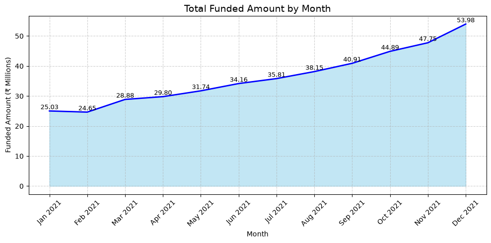
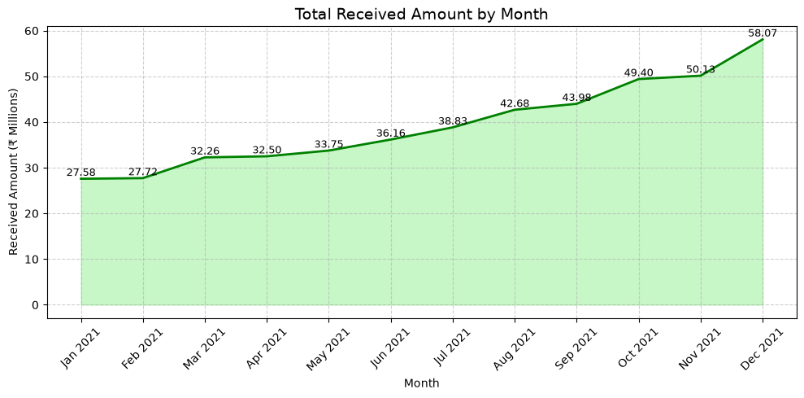
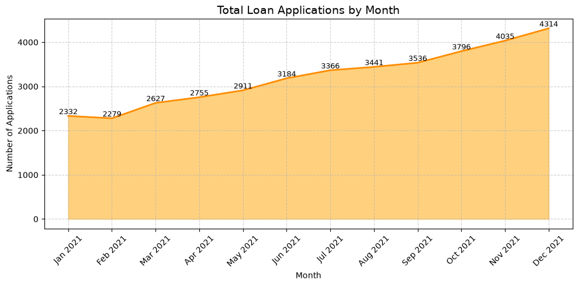
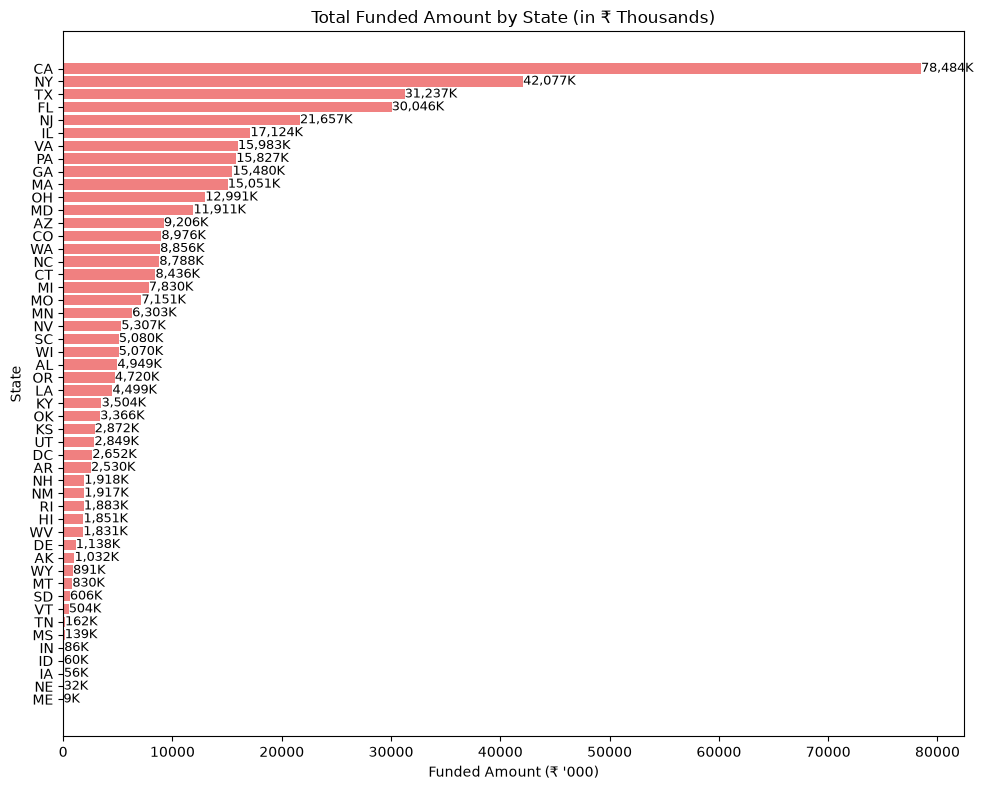
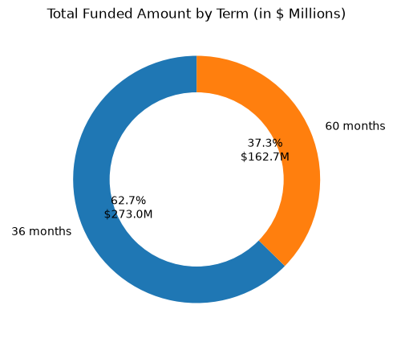
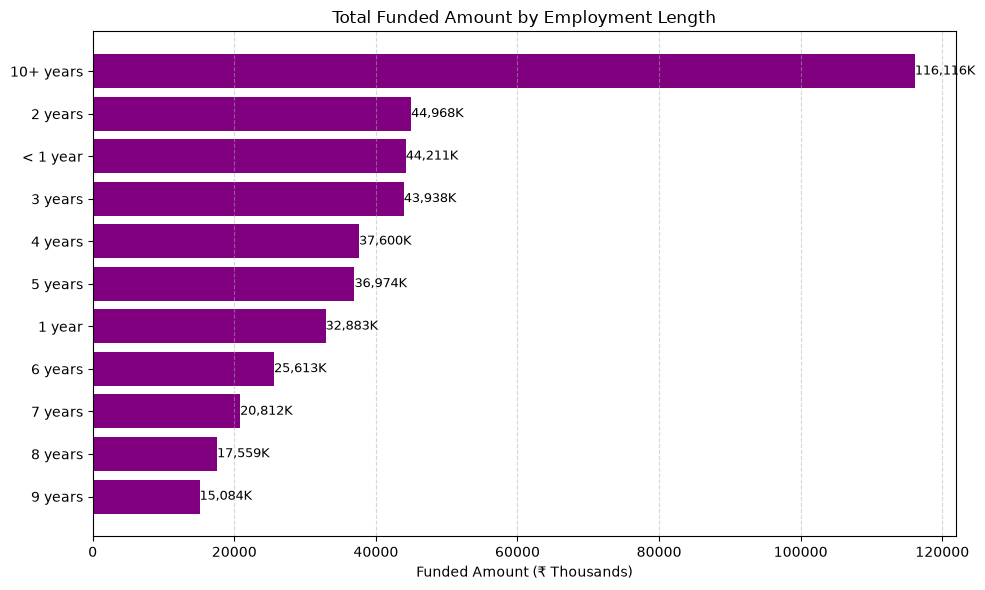
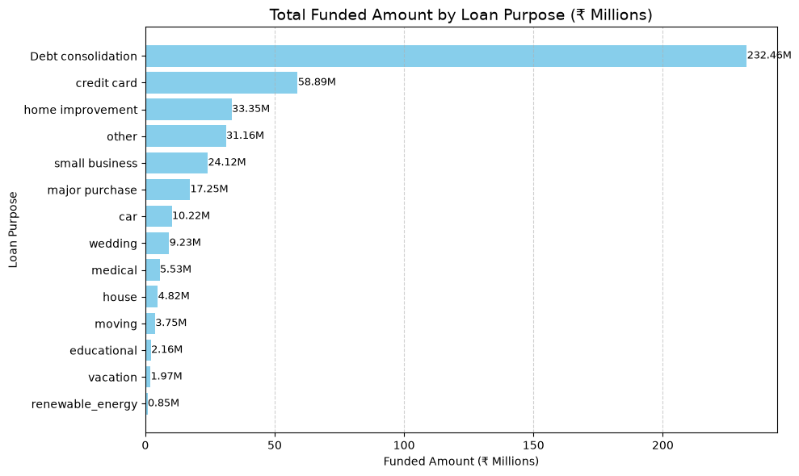
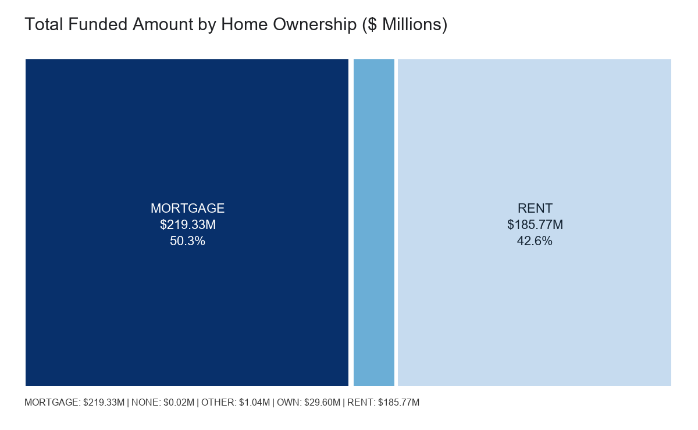

# Financial Loan Portfolio Analysis

An exploratory Jupyter notebook analyzing a 2021 loan portfolio. The notebook summarizes application volume, funded principal, payments recorded, loan status, and funding mix across time and borrower or loan categories. It also includes exported chart images in [`assets/`](assets/).

## Project files

| File | Description |
| --- | --- |
| [`financial_loan.ipynb`](financial_loan.ipynb) | Notebook containing data inspection, summary metrics, and visualizations. |
| [`financial_loan.xlsx`](financial_loan.xlsx) | Source workbook loaded by the notebook. |
| [`assets/`](assets/) | PNG exports of the notebook's eight graphs. |

## Run the notebook

Use Python with Jupyter and the packages imported by the notebook:

```bash
python -m pip install pandas numpy matplotlib seaborn plotly openpyxl jupyter
jupyter notebook financial_loan.ipynb
```

Open the notebook and run its cells from top to bottom. The first cell installs the `datasets` package, but the notebook does not use it for this analysis; it can be removed. The workbook-loading cell currently uses the absolute Windows path `C:\Financial_loan_python_pandas\financial_loan.xlsx`. To run the project from a different folder or operating system, change it to a project-relative path, for example:

```python
df = pd.read_excel("financial_loan.xlsx")
```

Run the notebook from the project directory so that relative path resolves. The notebook imports Seaborn and `warnings`, though neither is used in the current analysis.

## Dataset and scope

The workbook contains **38,576 loan records** and 24 columns. Issue dates run from **January 1 to December 12, 2021**. The data has no missing values in the analysis columns; `emp_title` is missing for 1,438 rows. Loan `id` values are unique in this file.

| Column | Meaning in this analysis |
| --- | --- |
| `id`, `member_id` | Loan and member identifiers. |
| `address_state` | Borrower's state. |
| `application_type` | Individual or joint application. |
| `emp_length`, `emp_title` | Employment tenure and title. |
| `grade`, `sub_grade` | Loan grades. |
| `home_ownership` | Reported home ownership category. |
| `issue_date` | Loan issue date; used for monthly grouping. |
| `last_credit_pull_date`, `last_payment_date`, `next_payment_date` | Credit-pull and payment-related dates. |
| `loan_status` | Status such as Fully Paid, Current, or Charged Off. |
| `purpose`, `term` | Loan purpose and repayment term. |
| `verification_status` | Income or information verification category. |
| `annual_income`, `dti`, `installment`, `int_rate` | Borrower income, debt-to-income ratio, installment, and interest rate. |
| `loan_amount`, `total_payment` | Funded principal and payment total recorded in the workbook. |
| `total_acc` | Total accounts recorded for the member. |

The workbook does not establish a currency in its column metadata. The notebook labels some graphs in dollars (`$`) and others in rupees (`₹`). Therefore, monetary values below are reported as **currency units** or **millions of currency units** as calculated from the workbook, not as a verified denomination. Confirm the source currency and make the labels consistent before external use.

## Headline results

| Metric | Result |
| --- | ---: |
| Applications / records | 38,576 |
| Total funded principal | 435.76 million currency units |
| Total payments recorded | 473.07 million currency units |
| Average interest rate | 12.05% |
| Average DTI | 13.33% |
| Fully Paid or Current records | 33,243 (86.18%) |
| Charged Off records | 5,333 (13.82%) |
| Funded principal for Fully Paid or Current | 370.22 million currency units |
| Funded principal for Charged Off | 65.53 million currency units |

The notebook calls Fully Paid and Current loans “good loans,” and calls Charged Off loans “bad loans.” These are its analysis groupings, not a validated credit-risk model. The Current group contains 1,098 loans that have not reached a final repayment outcome. The 13.82% charged-off share is a count share of records in this extract; it should not be interpreted as a fully developed loss rate without cohort maturity and outcome definitions.

## Graphs and interpretation

### Monthly trends

#### Funded amount by month



Funded principal grows from 25.03 million in January to 53.98 million in December. The monthly sums rise throughout the observed year.

#### Amount received by issue month



The payment totals rise from 27.58 million for January-issued loans to 58.07 million for December-issued loans. This groups `total_payment` by **issue month**, rather than by the calendar month payments were received. Earlier issue cohorts have had more time to accumulate payments, so this is not a monthly collections trend or a like-for-like performance comparison.

#### Applications by month



Application counts increase each month in the extract, from 2,332 in January to 4,314 in December. December's source data ends on December 12, so its count is for the observed records through that date, not a complete calendar month. The pattern alone does not explain why volume increased or establish a forecast.

### Funding mix

#### Funded amount by state



California has the largest state total at 78.48 million, followed by New York at 42.08 million. The smallest is Maine at 9,200 currency units. These are raw totals: they reflect both the number of loans and their sizes, and should not be treated as per-borrower or risk comparisons.

#### Funded amount by loan term



Thirty-six-month loans account for 273.04 million funded across 28,237 records; 60-month loans account for 162.72 million across 10,339 records. The chart compares total principal, not average balance, repayment performance, or default frequency.

#### Funded amount by employment length



The 10+ years group has the largest funded total at 116.12 million. The chart sums principal by employment-length category; it does not show average loan size or whether tenure is associated with repayment outcomes. The categories are ordered by funded total in the chart, not by tenure.

#### Funded amount by loan purpose



Debt consolidation is the largest purpose category at 232.46 million, followed by credit cards at 58.89 million. Renewable energy is the smallest at 0.85 million. These totals combine category volume and loan size.

#### Funded amount by home ownership



Mortgage holders account for 219.33 million, renters for 185.77 million, and the `OWN` category for 29.60 million. `OTHER` and `NONE` are very small groups. The PNG is a raster recreation from the Plotly figure data stored in the notebook; it preserves the category values and proportions, but is not a screenshot of the original interactive Plotly rendering.

## Method and interpretation notes

- “MTD” cells select all rows in the latest month present in the data. Since the latest issue date is December 12, 2021, the reported 4,314 applications, 53.98 million funded, and 58.07 million received are **December-to-date in the extract**, not necessarily a complete month.
- `total_payment` is grouped by the loan's issue month in the monthly payment graph. It is not grouped by payment date.
- The notebook sums funding by state, term, employment length, purpose, and home ownership. It does not normalize totals by record count or borrower characteristics.
- Summary metrics are descriptive. No hypothesis tests, predictive model, vintage analysis, or causal analysis is performed.
- The notebook's embedded chart outputs are snapshots. Re-running cells may redraw charts, and running the Plotly treemap requires Plotly in the Python environment.

## Assets

The chart files can be reused independently of the notebook:

- [`funded_amount_by_month.png`](assets/funded_amount_by_month.png)
- [`amount_received_by_month.png`](assets/amount_received_by_month.png)
- [`applications_by_month.png`](assets/applications_by_month.png)
- [`funded_amount_by_state.png`](assets/funded_amount_by_state.png)
- [`funded_amount_by_term.png`](assets/funded_amount_by_term.png)
- [`funded_amount_by_employment_length.png`](assets/funded_amount_by_employment_length.png)
- [`funded_amount_by_purpose.png`](assets/funded_amount_by_purpose.png)
- [`funded_amount_by_home_ownership.png`](assets/funded_amount_by_home_ownership.png)
